# HesapLab

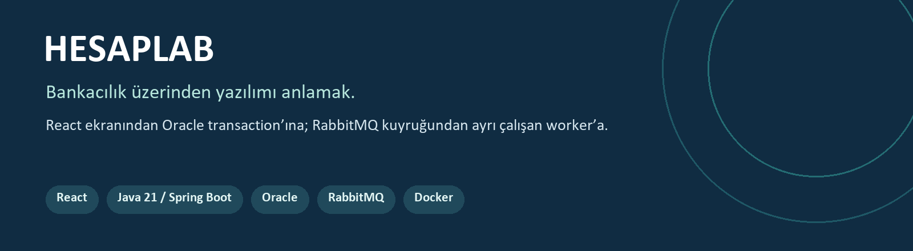

**Hesapları görüntüleme, güvenli transfer ve arka planda dekont hazırlama akışını uçtan uca inceleyen bir eğitim projesi.**

React arayüzü, Java/Spring Boot API’si ve Oracle veritabanı birlikte çalışır. Para transferi tek transaction’da tamamlanır; metin dekontu RabbitMQ üzerinden ayrı bir worker tarafından hazırlanır.

> Tamamen demo veriler kullanılır. Gerçek para, gerçek müşteri bilgisi veya banka bağlantısı yoktur.

[Ekranlar](#ekran-görüntüleri) · [Mimari](#mimari) · [Oracle modeli](#oracle-veri-modeli) · [Çalıştırma](#yerelde-çalıştırma) · [Testler](#testler-ve-doğrulama) · [Belgeler](#belgeler)

## Neler yapılabiliyor?

| Müşteri | Yönetici |
| --- | --- |
| Oturum açma/kapama; yalnız kendi hesaplarına erişim | Kullanıcıları ve hesapları listeleme |
| Hesap arama, bakiye gizleme ve hesap ayrıntısı | Yeni CUSTOMER oluşturma |
| En yeni 50 hesap hareketini görüntüleme | Mevcut CUSTOMER adına sıfır bakiyeli TRY hesabı açma |
| Kendi veya başka bir müşterinin hesabına transfer | Müşterinin görünen adını ve hesap adını düzenleme |
| Hesap numarasıyla alıcı doğrulama; taslak ve ayrı işlem onayı | Müşteri transfer yetkisi verilmeden ayrı yönetim ekranı |
| Gönderilen transferin metin dekontunu görüntüleme | Rol ve CSRF kontrolleriyle sınırlandırılmış işlemler |

### Dikkat edilen teknik noktalar

- **Atomik transfer:** transfer, iki bakiye, iki hareket, ilk dekont ve outbox kaydı aynı Oracle transaction’ında yazılır. Finansal yazımlardan biri başarısızsa tamamı geri alınır.
- **Eşzamanlılık:** hesaplar küçük kimlikten büyüğe doğru kilitlenir. Bakiye kontrolü kilit alındıktan sonra yapılır; kilit bekleme süresi sınırlıdır.
- **Idempotency:** aynı kullanıcı, aynı anahtar ve eşdeğer içerikle tekrar gönderdiğinde aynı transfer sonucu alınır. Aynı anahtarla farklı içerik `409` döndürür.
- **Güvenlik:** Spring Security oturumu, BCrypt parola hash’i ve CSRF kontrolü kullanılır. Hesap sahipliği backend’de ve SQL koşullarında denetlenir; alıcı API’si bakiye açıklamaz.
- **Asenkron dekont:** transfer sonucu dekontun hazırlanmasını beklemez. Worker hatası, commit edilmiş para transferini geri almaz.
- **Mesaj güvenilirliği:** transactional outbox, publisher confirm, toplam üç işleme denemesi ve DLQ bulunur. Yinelenen teslim mümkündür; worker `READY` kontrolüyle aynı sonucu korur.

## Ekran görüntüleri

Aşağıdaki görseller çalışan yerel uygulamadan alınmıştır. Gösterilen kişiler, hesap numaraları ve tutarlar demo veridir. Görsellere tıklayarak tam boy açabilirsiniz.

<table>
  <tr>
    <td width="50%"><strong>Giriş</strong><br><a href="docs/images/login.jpg">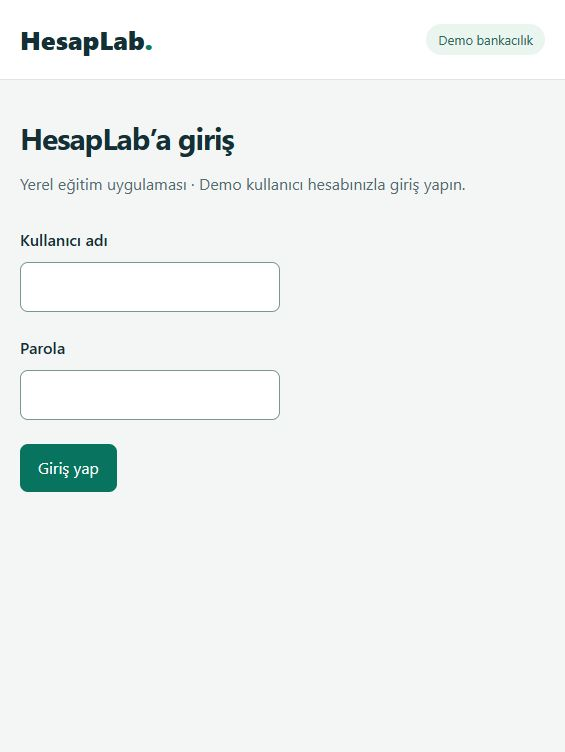</a></td>
    <td width="50%"><strong>Hesaplarım</strong><br><a href="docs/images/accounts.jpg">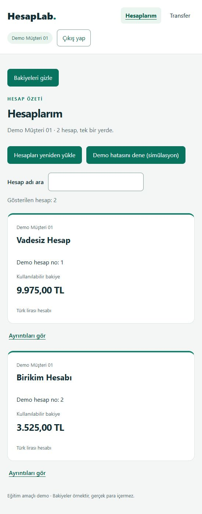</a></td>
  </tr>
  <tr>
    <td><strong>Hesap ayrıntısı ve hareketler</strong><br><a href="docs/images/account-details.jpg">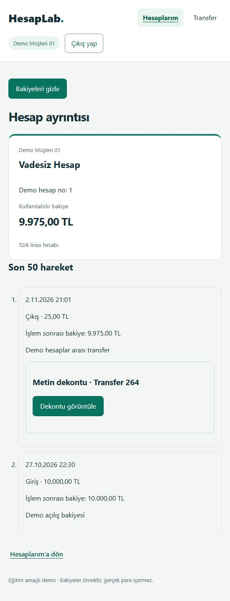</a></td>
    <td><strong>Transfer taslağı ve ayrı onay</strong><br><a href="docs/images/transfer.jpg">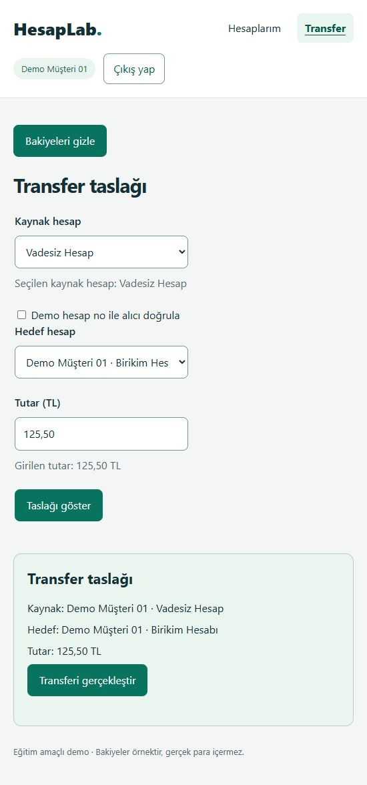</a></td>
  </tr>
  <tr>
    <td><strong>Başka müşteriye alıcı doğrulama</strong><br><a href="docs/images/recipient.jpg">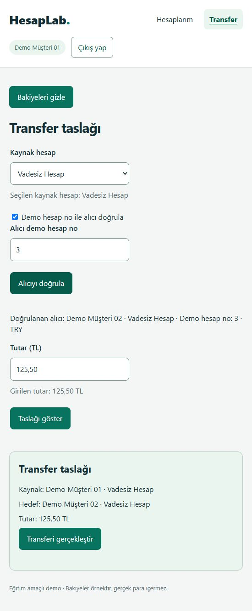</a></td>
    <td><strong>Worker’ın hazırladığı metin dekontu</strong><br><a href="docs/images/receipt.jpg">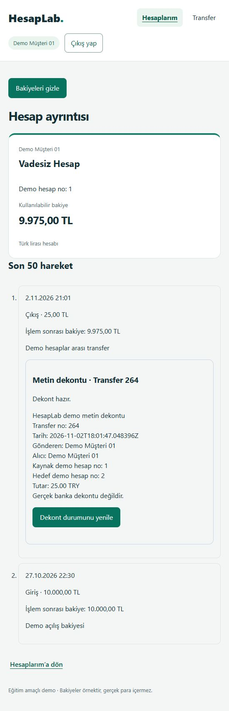</a></td>
  </tr>
  <tr>
    <td><strong>Yönetim — müşteri ve ad düzenleme</strong><br><a href="docs/images/admin-full.jpg">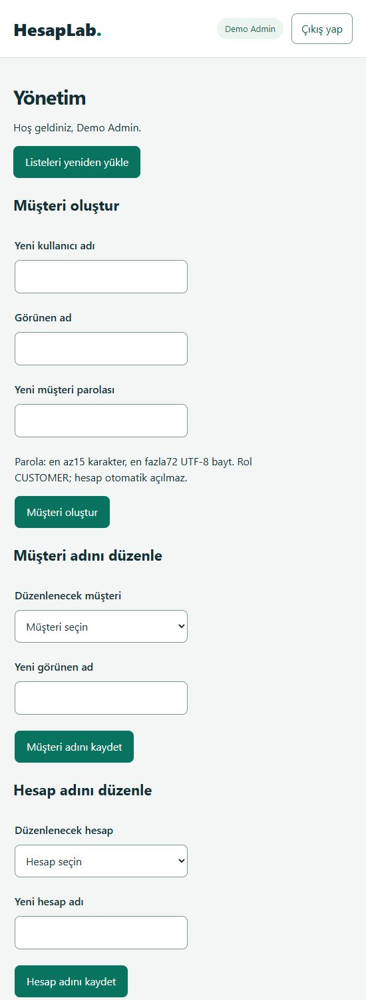</a></td>
    <td><strong>Yönetim — kullanıcılar ve hesap açma</strong><br><a href="docs/images/admin-accounts.jpg">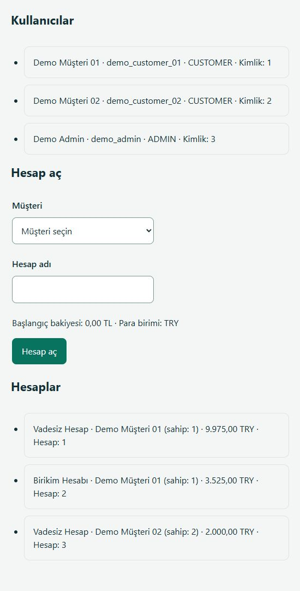</a></td>
  </tr>
</table>

<details>
<summary>Bulunamayan sayfa görünümü</summary>

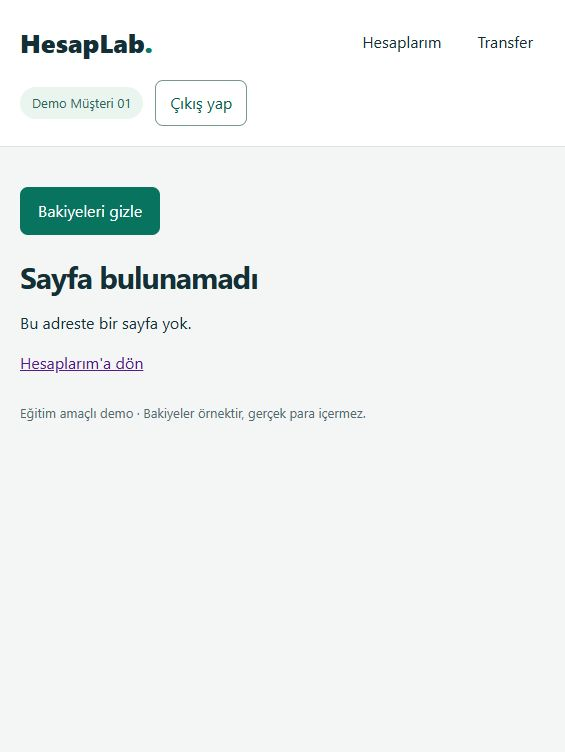

</details>

| Adres | Görevi |
| --- | --- |
| `/` | Oturuma göre giriş, müşteri veya yönetim akışı |
| `/hesaplar` | Müşterinin kendi hesapları |
| `/hesaplar/:accountId` | Sahiplik kontrollü hesap ayrıntısı ve hareketler |
| `/transfer` | Alıcı doğrulama, taslak, ayrı transfer onayı |
| `/admin` | Yalnız ADMIN için yönetim |
| Bilinmeyen adres | CUSTOMER için dönüş bağlantılı 404 görünümü |

## Mimari

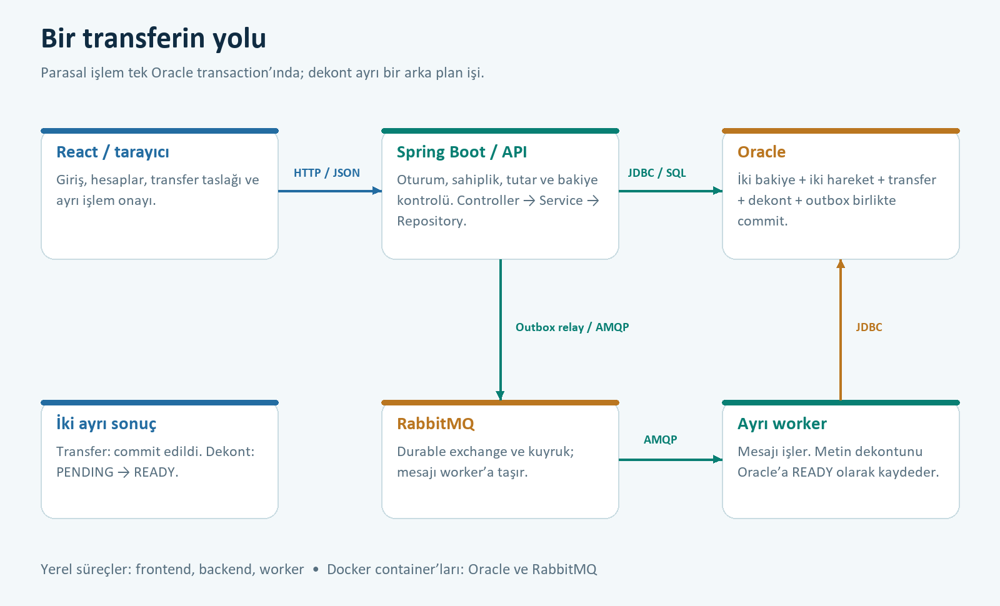

**Finansal yol:** `React → HTTP/JSON → Controller → Service → Repository → Oracle`.

**Dekont yolu:** `Aynı transaction’da outbox → relay → RabbitMQ → ayrı worker → Oracle’da READY → React’in GET isteği`.

`SENT`, mesajın broker tarafından onaylandığını; `READY`, worker’ın dekont içeriğini kaydettiğini anlatır. Bunlar iki ayrı aşamadır. Ekran, dekont durumunu açılışta veya kullanıcı yenilediğinde GET ile okur.

Backend ve worker ayrı Java programlarıdır; mevcut tasarımda aynı Oracle şemasını paylaşırlar. Backend içinde Controller–Service–Repository katmanları, constructor ile dependency injection, DTO’lar ve ayrı servis modülleri kullanılır.

### Teknolojiler

| Katman | Kullanılanlar | Projedeki görevi |
| --- | --- | --- |
| Arayüz | React 19, JavaScript, React Router 8, Vite 8 | Component, props/state, form, routing ve API bağlantısı |
| Backend | Java 21, Spring Boot 3.5.16, Spring Security | REST API, oturum, yetki ve iş kuralları |
| Veri erişimi | Spring JDBC / JdbcTemplate, Oracle JDBC | Açık SQL, satır kilitleri ve transaction sınırı |
| Veritabanı | Oracle AI Database Free | Hesap, transfer, hareket, dekont ve outbox kayıtları |
| Mesajlaşma | RabbitMQ 4.4, Spring AMQP | Dekont kuyruğu, confirm, retry ve DLQ |
| Worker | Ayrı Java 21 / Spring Boot uygulaması | Kuyruktaki dekont işlerini işleme |
| Yerel ortam | Docker Compose, Maven Wrapper, npm | Veritabanı/broker container’ları ve uygulama araçları |
| Kontroller | JUnit / Spring Boot Test, gerçek Oracle ve RabbitMQ senaryoları, Oxlint | Birim/entegrasyon ve arayüz kontrolleri |

## Oracle veri modeli

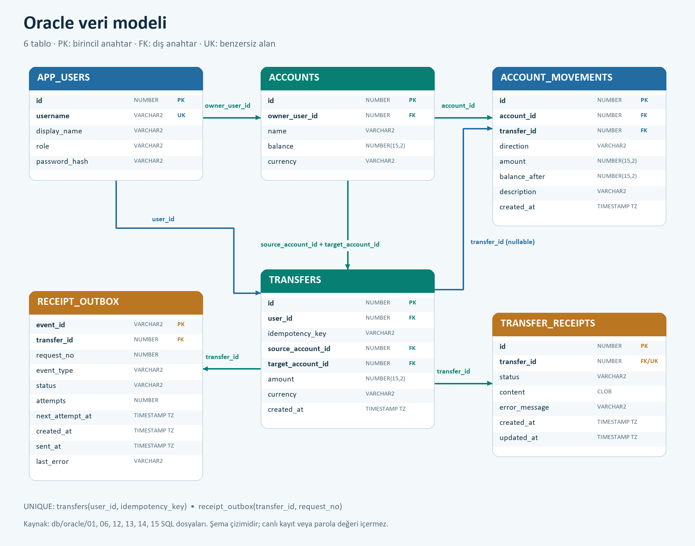

Bu görsel SQL dosyalarından hazırlanmış **şema diyagramıdır**; canlı kayıt veya parola değeri içermez. Tam boy okumak için görsele tıklayın. [Ayrıntılı model ve kısıtlar →](docs/DATABASE_MODEL.md)

| Tablo | Ne tutar? |
| --- | --- |
| `app_users` | Kullanıcı adı, görünen ad, rol ve parola hash’i |
| `accounts` | Hesabın sahibi, adı, güncel bakiyesi ve para birimi |
| `transfers` | Tamamlanmış transfer; kullanıcı kapsamındaki idempotency anahtarı |
| `account_movements` | CREDIT/DEBIT geçmişi ve işlem sonrası bakiye |
| `transfer_receipts` | Her transferin PENDING / READY / FAILED dekont durumu ve metni |
| `receipt_outbox` | Yayımlanacak dekont olayları, deneme bilgisi ve PENDING / SENT durumu |

Para Java’da `BigDecimal`, Oracle’da `NUMBER(15,2)` ile işlenir. API’de kimlikler ve parasal değerler metin olarak taşınır. Foreign key kayıt ilişkisini sağlar; kullanıcının rolü ve sahipliği ayrıca backend’de doğrulanır.

## Yerelde çalıştırma

**Gerekenler:** JDK 21, Node.js/npm, Docker Desktop. Maven Wrapper repoya dahildir. Bu proje Windows/PowerShell üzerinde geliştirilmiştir.

```powershell
git clone https://github.com/berk-celikten/hesaplab.git
cd hesaplab
```

### 1. İlk kurulum

İlk kurulum ile daha önce hazırlanmış ortamı açmak farklı işlemlerdir.

1. `db/oracle/.env.local` içinde `ORACLE_PASSWORD`, `APP_USER=HESAPLAB`, `APP_USER_PASSWORD`; `infra/rabbitmq/.env.local` içinde `RABBITMQ_USER`, `RABBITMQ_PASSWORD` değerlerini yerel olarak hazırlayın. Bu dosyalar Git dışındadır.
2. Oracle ve RabbitMQ’yu başlatın; iki servisin de `healthy` olmasını bekleyin:

   ```powershell
   docker compose -f db/oracle/compose.yaml up -d --wait
   docker compose --env-file infra/rabbitmq/.env.local -f infra/rabbitmq/compose.yaml up -d --wait
   ```

3. Yeni ve boş `HESAPLAB` şemasında SQL Developer veya SQL*Plus kullanarak sırasıyla `01`, `02`, `06`, `07`, `12`, `13`, `14`, `15` numaralı SQL dosyalarını uygulayın. Bunlar [db/oracle](db/oracle) altındadır. Seed DML kayıtlarını commit edin. Mevcut şemada kurulumu tekrarlamayın; eksik migration’ı önce metadata’dan kontrol edin.
4. Backend’i paketledikten sonra, yalnız ilk demo parola hazırlığı için backend dizininde `prepare-passwords` profilini çalıştırın:

   ```powershell
   cd backend
   .\mvnw.cmd package
   & "$env:JAVA_HOME/bin/java.exe" -jar target/hesaplab-backend-0.0.1-SNAPSHOT.jar --spring.profiles.active=prepare-passwords
   cd ..
   ```

   `JAVA_HOME`, kurulu JDK 21 klasörünü göstermelidir. Demo girişleri yalnız `.tools/demo-logins.local.json` dosyasına yazılır; normal açılış parola üretmez veya mevcut parolayı değiştirmez.
5. Backend/worker kuyruğu tanımladıktan sonra yalnız dekont kuyruğuna DLQ policy’sini uygulayın:

   ```powershell
   ./infra/rabbitmq/configure-receipt-dlq.ps1
   ```

### 2. Günlük açılış

Mevcut Oracle/RabbitMQ container’ları açık ve sağlıklıyken, **üç ayrı terminalde** proje kökünden:

| Terminal | Komutlar |
| --- | --- |
| Backend | `cd backend` → `.\mvnw.cmd spring-boot:run` |
| Worker | `cd worker` → `.\mvnw.cmd spring-boot:run` |
| Frontend | `cd frontend` → ilk kurulumda `npm ci` → `npm run dev -- --host 127.0.0.1 --port 5181 --strictPort` |

| Servis | Yerel adres |
| --- | --- |
| Arayüz | http://127.0.0.1:5181 |
| Spring Boot API | http://127.0.0.1:8081 |
| Oracle | `127.0.0.1:1522/FREEPDB1` |
| RabbitMQ AMQP | `127.0.0.1:5673` |
| RabbitMQ yönetim | http://127.0.0.1:15673 |

Worker HTTP portu açmaz. Vite, `/api` isteklerini backend’e yönlendirir. Hesaplar ve hareketler gerçek yerel Oracle’dan gelir; sessiz demo veri yedeği kullanılmaz.

**Başlatma/durdurma, port çakışması, paketleme ve toparlanma:** [RUNBOOK.md](docs/RUNBOOK.md). Mevcut veriyi korumak için şema/seed dosyalarını günlük açılışta çalıştırmayın; volume silme işlemi normal durdurmanın parçası değildir.

## Testler ve doğrulama

Önceki tam doğrulamada **37 backend + 14 worker testi** başarılıdır. Oracle rollback/paralellik, sahiplik, idempotency replay, broker/worker kesintileri, retry/DLQ ve outbox toparlanma senaryoları kapsanmıştır. Arayüz için build/lint, gerçek tarayıcı, klavye ve dar ekran kontrolleri ayrıca kaydedilmiştir.

Bu sayılar geçmiş doğrulama kaydıdır; README görselleri hazırlanırken testler ve migration’lar yeniden çalıştırılmamıştır. Kaynakları ve denenmeyen sınırlarıyla ayrıntılar [geliştirme/doğrulama arşivindedir](docs/DEVELOPMENT_HISTORY.md).

```powershell
# frontend dizininde
npm run build
npm run lint

# backend ve worker dizinlerinde ayrı ayrı
.\mvnw.cmd test
```

Gerçek Oracle entegrasyon testleri ayrıca `HESAPLAB_ORACLE_TEST=true` gerektirir; bu testler için test kayıtlarının normal worker/relay ile yarışmasını önleyen kontrollü ortam kullanılmalıdır. [Test çalıştırma notları →](docs/RUNBOOK.md)

## Kapsam ve sınırlar

Bu sürüm bir **eğitim demosudur**. Üretim bankacılığı veya tam mikroservis mimarisi iddiası taşımaz.

- Tek para birimi TRY’dir. Dekont metindir; ekstre, PDF/e-posta üretimi ve banka entegrasyonu bulunmaz.
- Yönetim; listeleme, CUSTOMER oluşturma, hesap açma ve ad düzenlemeyle sınırlıdır. Silme, pasifleştirme, hesap kapatma ve rol/parola yönetimi yoktur.
- İstemcinin transfer anahtarı bellektedir; sayfa yenileme/çıkışta kaybolabilir. Kalıcı istemci kurtarma akışı yoktur.
- Outbox ve idempotent worker yinelenen teslimi ele alır; **exactly-once veya mutlak kayıpsız teslim garantisi verilmez**. `SENT`, dekontun `READY` olması değildir.
- Yerel HTTP ve oturum düzeni; üretimde HTTPS, secret yönetimi, izleme, yedekleme, session ölçekleme ve yük testleri gerektirir.

## Proje yapısı

```text
hesaplab/
├── frontend/                 # React ekranları, component’ler ve API servisleri
├── backend/                  # auth, account, transfer, admin, receipt paketleri
├── worker/                   # RabbitMQ consumer ve dekont işleyicisi
├── db/oracle/                # Şema, migration, seed, SQL alıştırmaları
├── infra/rabbitmq/           # Compose ve dekont DLQ policy betiği
└── docs/                     # Model, işletim, görseller ve öğrenme notları
```

## Belgeler

- [Çalıştırma ve sorun giderme](docs/RUNBOOK.md)
- [Oracle veri modeli ve kısıtlar](docs/DATABASE_MODEL.md)
- [Geliştirme ve doğrulama geçmişi](docs/DEVELOPMENT_HISTORY.md)
- [Ayrıntılı öğrenme planı](docs/LEARNING_PLAN.md)
- [Kısa güncel durum](docs/STATE.md)
- [Çalışma kuralları](AGENTS.md)

Proje; React, Java/Spring Boot, Oracle transaction’ları ve asenkron/dağıtık iş akışlarını uygulayarak öğrenmek için geliştirilmiştir. AI desteğiyle görev tanımlama, kod inceleme ve sonuç doğrulama da çalışma sürecinin parçasıdır.
