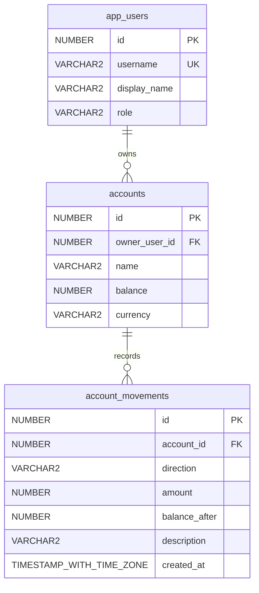

# Oracle veri modeli — 6.1–6.7 ve 7.2

Kullanıcı, hesap ve hareket tabloları yerel Oracle AI Database 26ai Free 23.26.3.0.0 üzerinde oluşturuldu.
SQL, Oracle 19c söz dizimi hedefiyle yazıldı; Oracle 19c sunucusunda ayrıca denenmedi.
Dosyaların hazırlanması, Berk'in bu konuları öğrendiği anlamına gelmez.

## Tablo, satır ve sütun

`app_users` kullanıcıları, `accounts` hesapları tutan tablolardır.
Bir satır tek kullanıcıyı veya tek hesabı temsil eder. Sütun o kaydın bir bilgisidir:
örneğin `display_name` kullanıcı adı gösterimini, `balance` hesap bakiyesini tutar.

Her tablonun `id` sütunu primary key'dir: her satırı benzersiz tanımlar.
`NUMBER GENERATED ALWAYS AS IDENTITY` sayesinde kimliği Oracle üretir; seed kimlik vermez.
Bu sayısal kimlikler React'teki `checking`, `savings`, `checking-02` ve `customer-01/02`
demo kimliklerinden ayrıdır; React verileri ve kimlikleri değiştirilmedi.



`accounts.owner_user_id`, `app_users.id` sütununa foreign key ile bağlıdır.
Bir kullanıcı sıfır veya daha çok hesaba sahip olabilir; her hesap bir kullanıcıya bağlıdır.
SQL dosyasından hazırlanıp görsel olarak kontrol edilen [ER resmi](diagrams/hesaplab-er.png) yalnız önceki iki tabloyu (app_users/accounts) ve aralarındaki ilişkiyi gösterir; account_movements içermez ve canlı veritabanı görünümü değildir.
Foreign key kullanıcının varlığını sağlar; rolünün CUSTOMER olduğunu tek başına garanti etmez.
Rol denetimi sonraki backend konusudur. `role` kısıtı yalnız CUSTOMER/ADMIN değerlerini kabul eder.
Demo admin'e hesap veya transfer yetkisi atanmadı; parola ve gerçek giriş sistemi yoktur.

## Para ve demo sahipliği

`balance NUMBER(15,2)` sayısal değer tutar: örneğin `10000.00`.
React'teki `10.000,00 TL` ise kullanıcıya sunulan biçimlendirilmiş metindir.
Veritabanında binlik ayırıcı veya TL metni bakiyeye eklenmez; para birimi ayrı `currency` sütunundadır.
Bakiye varsayılanı 0'dır, NULL/negatif olamaz. Para birimi varsayılan ve tek kabul edilen değer TRY'dir.
Kullanıcı adı benzersiz ve zorunlu; görünen ad, rol, hesap sahibi ve hesap adı da zorunludur.

| Kullanıcı adı | Rol | Hesap | Sayısal bakiye |
| --- | --- | --- | --- |
| demo_customer_01 | CUSTOMER | Vadesiz Hesap | 10000.00 |
| demo_customer_01 | CUSTOMER | Birikim Hesabı | 3500.00 |
| demo_customer_02 | CUSTOMER | Vadesiz Hesap | 2000.00 |
| demo_admin | ADMIN | Hesap yok | — |

## Uygulama durumu

Yerel ortam `db/oracle/compose.yaml` ile hazırlandı. Konteyner `hesaplab-oracle`,
ayrı veri alanı `hesaplab-oradata`, imaj `gvenzl/oracle-free:23.26.3-slim-faststart`.
Yalnız `127.0.0.1:1522` üzerinden erişilir; servis adı `FREEPDB1`, bağlantı kullanıcısı `HESAPLAB`.
`bankflow` konteynerine veya verisine komut uygulanmadı; onun 1521 portu kullanılmadı.

Bağlantı parolaları Git tarafından dışlanan `db/oracle/.env.local` içindedir.
Bu yerel dosya ORACLE_PASSWORD, APP_USER=HESAPLAB ve APP_USER_PASSWORD anahtarlarını içerir.
HESAPLAB, Oracle bağlantı kullanıcısıdır; app_users içindeki demo müşteriler ve ADMIN ise uygulama kayıtlarıdır.

Proje kökünden başlatma ve veri alanını koruyarak durdurma:
```sh
docker compose -p hesaplab-oracle -f db/oracle/compose.yaml up -d
docker compose -p hesaplab-oracle -f db/oracle/compose.yaml stop
```

`01_schema.sql` ve ardından `02_seed.sql` SQL*Plus ile başarıyla uygulandı; COMMIT tamamlandı.
İlk kurulum dosyaları boş şemaya bir kez uygulanır; mevcut şemada tekrar çalıştırılmamalıdır.
`03_read_queries.sql` salt okunur sorgular içerir ve tekrar çalıştırılabilir.
Gerçek sorgular üç kullanıcı ve üç hesabı; 10000.00, 3500.00 ve 2000.00 TRY tutarlarını doğruladı.
React henüz Oracle'a bağlı değildir; mevcut demo servisi korunur.

## Grafik arayüzü: VS Code içinde Oracle SQL Developer

Resmî `Oracle.sql-developer` 26.3.0 eklentisi kuruldu; `HesapLab` bağlantısı kaydedildi.
SQL Developer kenar çubuğunda `Connections → HesapLab → Tables` yolunu açın.
`APP_USERS` ve `ACCOUNTS` tablolarının `Data` sekmesi gerçek kayıtları, `Columns` sekmesi sütun yapısını gösterir.
Yönetici APP_USERS sütunlarını/üç kullanıcıyı ve ACCOUNTS içindeki üç hesabı grafik arayüzünde doğruladı.

ER görünümü için [hesaplab.dgm](diagrams/hesaplab.dgm) dosyasını VS Code'da açın; gerekirse `Fit to Screen` kullanın.
Dosya, bağlantı adı ve üç tablonun adları/yerleşimini tutar; SQL Developer sütunları ve kısıtları Oracle'dan okur.
7.2 ile native dosyaya `ACCOUNT_MOVEMENTS` eklendi. Yönetici kaydedilmemiş asıl diyagramı koruyup ayrı bir dosya kopyasında üç tabloyu, `FK_ACCOUNTS_OWNER` ve `FK_MOVEMENTS_ACCOUNT` çizgilerini görsel olarak doğruladı.
Genel yöntem bağlantıya sağ tık → `Open Diagram`; ardından `Tables` sürüklenirken bırakmadan Shift'e basmaktır.
Bu ortamda sürükleme ve boş diyagramdaki arama sonuç vermedi; nedeni belirlenmedi, dosya açma yöntemiyle görüntüleme sağlandı.
Kaynak: [Oracle — Working with Diagrams](https://docs.oracle.com/en/database/oracle/sql-developer-vscode/26.3/sqdnx/using-schema-diagrams.html).

Kaynak: [Oracle 19c CREATE TABLE](https://docs.oracle.com/en/database/oracle/oracle-database/19/sqlrf/CREATE-TABLE.html).

## Hesap hareketleri (7.2)
Bir hesap sıfır veya çok hareket içerir; her hareket `account_id` foreign key'iyle tek hesaba bağlıdır.
`06_account_movements_schema.sql` yalnız yeni tabloyu oluşturur; mevcut şema dosyasını yeniden çalıştırmayın.

| Sütun | Kural |
| --- | --- |
| id | NUMBER, GENERATED ALWAYS AS IDENTITY, primary key |
| account_id | NUMBER, zorunlu, accounts.id foreign key |
| direction | VARCHAR2(6 CHAR), zorunlu; CREDIT veya DEBIT |
| amount | NUMBER(15,2), zorunlu; sıfırdan büyük |
| balance_after | NUMBER(15,2), zorunlu; negatif olamaz |
| description | VARCHAR2(200 CHAR), isteğe bağlı |
| created_at | TIMESTAMP WITH TIME ZONE, varsayılan SYSTIMESTAMP, zorunlu |

`accounts.balance` güncel bakiyedir. `balance_after`, ilgili hareketin hemen sonrasındaki geçmiş bakiyedir.
CREDIT giriş, DEBIT çıkış yönüdür; `amount` iki durumda da pozitif tutulur.
Bakiye ile geçmiş kaydın tutarlılığı bu sütun kısıtlarıyla tek başına sağlanmaz.
İleride transferde bakiye değişiklikleri ve hareketler aynı Oracle transaction'ında işlenecek; bu görev transfer uygulamaz.

`07_account_movements_seed.sql`, mevcut pozitif bakiyelere karşılık birer **canlandırılmış** açılış CREDIT kaydı ekler.
Tutar ve hareket sonrası bakiye, mevcut hesap bakiyesinden alınır; açıklama “Demo açılış bakiyesi”dir.
Hareketi bulunan hesap atlanır; sıfır bakiyeli hesap için kayıt üretilmez. Mevcut kullanıcı/hesap/bakiyeler değiştirilmez.
Bu basit seed ardışık tekrar çalıştırma için kontrol içerir; eşzamanlı istek idempotency çözümü değildir.
`08_account_movements_queries.sql`, hareketi hesap/sahip/güncel bakiye ile birleştirir; hesap, zaman, hareket kimliği sırasını kullanır.

Geliştirici mevcut Oracle'da 06/07/08'i SQL*Plus ile uyguladı: üç açılış kaydı, doğru sahiplik ve 10000/3500/2000 doğrulandı.
Seed tekrarında 0 kayıt eklendi; toplam 3 kaldı. Geçersiz hesap ORA-02291; geçersiz yön, sıfır/negatif tutar ve negatif balance_after ORA-02290 ile reddedildi.
Denemeler savepoint/rollback ile temizlendi; son toplam yine 3, hesap bakiyeleri değişmedi. Kimlik dizisinde boşluklar oluşabilir.
Bu uygulama ve kontroller, Berk'in konuyu öğrendiği anlamına gelmez.

Yönetici 06/07/08 ve ilgili belgeleri ayrıca inceledi. 08 sorgusunu SQL*Plus ile çalıştırıp üç açılış kaydını, tutar/sahiplik/zaman alanlarını doğruladı; seed'in COMMIT içermeyen tekrarını savepoint/rollback ile kontrol etti: 0 ek kayıt, son toplam 3, çıkış 0. Metadata'da 7 sütun ve 11 etkin/doğrulanmış kısıt görüldü; geliştiricinin negatif denemeleri ayrıca tekrarlanmadı.
Geliştirici açık diyagramın kaydedilmemiş değişiklik uyarısında yeniden yüklemeyi iptal etmişti. Yönetici asıl sekmeyi koruyarak ayrı inceleme kopyasını açtı; üç tablo ve iki FK ilişkisi Fit to Screen ile görsel doğrulandı. Kullanıcının unsaved sorgusu ve asıl diyagramı korundu. Statik PNG hâlâ eski iki tabloyu gösterir.
Kaynak: [Oracle 19c SYSTIMESTAMP](https://docs.oracle.com/en/database/oracle/oracle-database/19/sqlrf/SYSTIMESTAMP.html).
